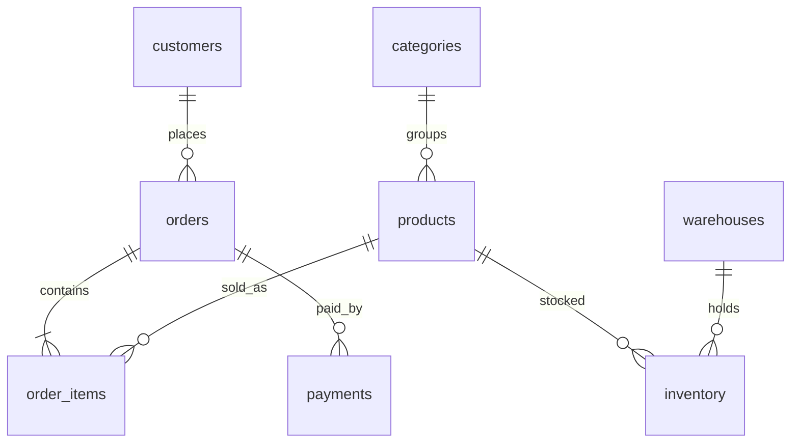

# SQL Shop Optimization

Навчальний проєкт на тему, з якою ІТ-фахівці стикаються щодня: **адмінка інтернет-магазину**.

Є замовлення, оплати, склад, пошук товарів і фінансові звіти. Запити спочатку написані так, як їх часто віддають з ORM або з першої ітерації фічі. Далі — ті самі екрани після індексів і переписування SQL.

Стек навмисно звичайний: **PostgreSQL 16 + Docker**. Нічого, крім Docker Desktop, ставити не потрібно.

## Що всередині

| Таблиця | Роль | Обсяг після seed |
| --- | --- | ---: |
| `customers` | покупці CRM | 10 000 |
| `products` / `categories` | каталог | 4 000 / 15 |
| `orders` | замовлення | 120 000 |
| `order_items` | позиції чека | 360 000 |
| `payments` | оплати | ~106 000 |
| `inventory` | залишки по 4 складах | 16 000 |



## Як запустити

1. Увімкніть [Docker Desktop](https://www.docker.com/products/docker-desktop/).
2. Якщо репозиторій лежить на OneDrive або в шляху з кирилицею і том не монтується — скопіюйте папку в `C:\dev\SQLShopOptimization`.
3. У PowerShell з кореня проєкту:

```powershell
.\scripts\demo.ps1 -Step all
```

Скрипт підніме Postgres на порту **5433**, наллє схему й дані, прожене 10 повільних запитів, створить індекси і прожене оптимізовані версії.

Покроково:

```powershell
.\scripts\demo.ps1 -Step init    # схема + дані
.\scripts\demo.ps1 -Step slow    # EXPLAIN без робочих індексів
.\scripts\demo.ps1 -Step index   # індекси після профайлінгу
.\scripts\demo.ps1 -Step fast    # переписані запити
.\scripts\demo.ps1 -Step reset   # прибрати індекси і повторити
.\scripts\demo.ps1 -Step down    # зупинити контейнер і том
```

Підключення вручну:

```text
host:     localhost
port:     5433
database: shop
user:     shop
password: shop
```

```powershell
.\scripts\psql.ps1
```

## Лабораторні

Кожна папка в `labs/` — окремий екран продукту. Є `slow.sql`, `fast.sql` і коротке пояснення.

| # | Екран | Що ламає запит | Що лікує |
| --- | --- | --- | --- |
| 01 | Історія замовлень клієнта | Seq Scan по `orders` | покриваючий індекс + Index Only Scan |
| 02 | Топ клієнтів за виручкою | корельований підзапит × N | агрегація `orders`, потім `JOIN` |
| 03 | Таблиця замовлень, стор. 800+ | `OFFSET 40000` | keyset-пагінація |
| 04 | Віджет «закінчується на складі» | підзапит категорії в `SELECT` | `JOIN` + partial index `quantity < 10` |
| 05 | Пошук у каталозі | `LIKE '%Wave%'` | `pg_trgm` + GIN |
| 06 | Останнє замовлення клієнта | два `LIMIT 1` на рядок | `LEFT JOIN LATERAL` |
| 07 | Замовлення без оплати | `NOT IN` | anti-join + partial index |
| 08 | Звіт продажів за місяць | `created_at::date` + `count(DISTINCT)` | діапазон + попередня агрегація |
| 09 | Повнотекстовий пошук | `lower(name) LIKE` | `to_tsvector` + GIN |
| 10 | Накопичена виручка | корельований `SUM` по днях | `sum() OVER (ORDER BY day)` |

Додатково `sql/05_materialized_view.sql` показує, як важкий дашборд виносять у `MATERIALIZED VIEW`.

Шпаргалка по плану: [docs/explain-cheatsheet.md](docs/explain-cheatsheet.md).

## На що дивитися в плані

Після кожного запиту шукайте три рядки:

- `Seq Scan` → `Index Scan` / `Index Only Scan`
- `Execution Time`
- `Buffers: shared read` (диск) vs `shared hit` (кеш)

На ноутбуці різниця зазвичай від **десятків мс до секунд**. Саме так виглядає оптимізація на проді, коли таблиця росте.

## Типові граблі, зібрані в цьому репо

1. Індекс «є», але колонка обгорнута в функцію — планувальник його не бере.
2. ORM згенерував `SELECT *` і N+1 / корельований підзапит.
3. Пагінація через `OFFSET` «працює» на перших сторінках і помирає на глибоких.
4. Пошук підрядка без trigram / full-text.
5. `NOT IN` і `NULL` дають або порожній результат, або важкий план.
6. Звіт рахують на льоту кожні 5 секунд замість матеріалізованого агрегу.
7. `count(DISTINCT)` після важкого JOIN замість попередньої агрегації.
8. Накопичувальний підсумок корельованим `SUM` замість `OVER (ORDER BY ...)`.

## Структура

```text
sql/                 схема, seed, індекси, matview
labs/0N_*/           повільний і швидкий SQL одного екрана
scripts/demo.ps1     повний прогін
docs/                як читати EXPLAIN
```
