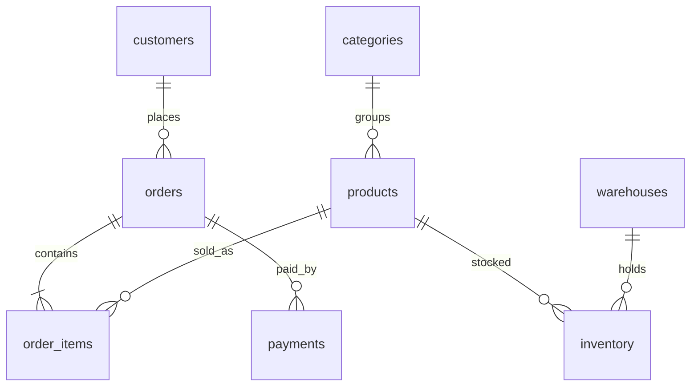

<p align="center">
  
</p>

<h1 align="center">SQL Shop Optimization</h1>

<p align="center">
  <strong>PostgreSQL performance lab on a real shop admin.</strong><br>
  120k orders · 10 production-shaped queries · slow plan vs rewritten SQL
</p>

<p align="center">
  
  
  
  
</p>

This is the kind of work a backend / DBA does when an admin screen dies in production: read `EXPLAIN (ANALYZE, BUFFERS)`, add the right index, then rewrite the query.

Not an ORM dump. Each lab is one screen — customer history, finance top-N, deep pagination, catalog search, unpaid orders, monthly report.

## Skills this repo shows

| Area | What is in the SQL |
| --- | --- |
| Indexes | covering `INCLUDE`, partial `WHERE`, BRIN on timestamps, GIN trigram + FTS |
| Query shape | `JOIN LATERAL`, anti-join, keyset pagination, pre-aggregation |
| Planner traps | function on a column, `NOT IN` + `NULL`, `OFFSET`, `count(DISTINCT)` |
| Reporting | window `sum() OVER`, `MATERIALIZED VIEW` |

## Dataset

| Table | Role | Rows |
| --- | --- | ---: |
| `customers` | CRM | 10 000 |
| `products` / `categories` | catalog | 4 000 / 15 |
| `orders` | checkout | 120 000 |
| `order_items` | line items | 360 000 |
| `payments` | capture / fail | ~106 000 |
| `inventory` | 4 warehouses | 16 000 |



## 10 labs

Every folder has `slow.sql` and `fast.sql`. Run both. Compare `Execution Time` and scan type.

| # | Screen | What is wrong | What fixes it |
| --- | --- | --- | --- |
| 01 | Customer order history | Seq Scan on `orders` | covering index, Index Only Scan, `LIMIT` |
| 02 | Top customers by revenue | correlated subquery × N | aggregate `orders`, then join |
| 03 | Admin order table, page 800+ | `OFFSET 40000` | keyset pagination |
| 04 | Low-stock widget | subquery per row | `JOIN` + partial index |
| 05 | Catalog search | `LIKE '%Wave%'` | `pg_trgm` + GIN |
| 06 | Last order per customer | two `LIMIT 1` per row | `LEFT JOIN LATERAL` |
| 07 | Paid orders without capture | `NOT IN` | anti-join + partial index |
| 08 | Monthly sales by category | `created_at::date`, `count(DISTINCT)` | range filter + pre-agg |
| 09 | Multi-word catalog search | `lower(name) LIKE` | `to_tsvector` + GIN |
| 10 | Running daily revenue | correlated running `SUM` | `sum() OVER (ORDER BY day)` |

How to read a plan: [docs/explain-cheatsheet.md](docs/explain-cheatsheet.md).

## Quick start

Docker Desktop, then from the repo root:

```powershell
.\scripts\demo.ps1 -Step all
```

That loads the schema, seeds data, runs the slow plans, applies indexes, runs the fast plans.

```powershell
.\scripts\demo.ps1 -Step init
.\scripts\demo.ps1 -Step slow
.\scripts\demo.ps1 -Step index
.\scripts\demo.ps1 -Step fast
```

Postgres: `localhost:5433` · db/user/password `shop`.

If Docker cannot mount a OneDrive / Cyrillic path, copy the folder to `C:\dev\SQLShopOptimization`.

## Repo map

```text
sql/           schema, seed, indexes, materialized view
labs/0N_*/     one admin screen, slow vs fast
scripts/       demo.ps1, psql.ps1
docs/          EXPLAIN notes
```

## Author

**Ruslan Babinets** · [github.com/Roman213r](https://github.com/Roman213r)

---

<details>
<summary>Українською</summary>

Навчальний проєкт під адмінку інтернет-магазину: замовлення, склад, пошук, фінансові звіти. Спочатку запити як з ORM, далі індекси й переписаний SQL. Стек — PostgreSQL 16 і Docker. Повний прогін: `.\scripts\demo.ps1 -Step all`.
</details>
